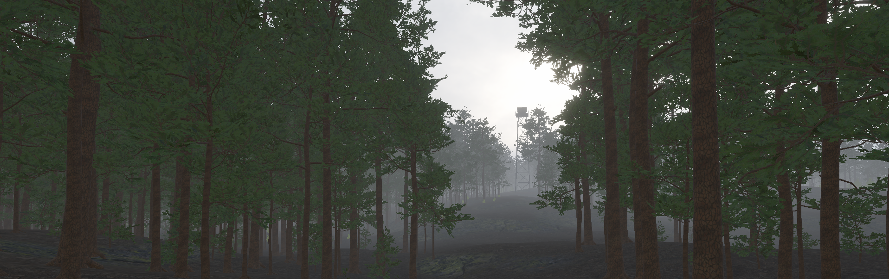

# Dead Pines

**A first-person survival horror game about being alone in the woods.**

Unity 6.3 LTS · URP · C# · solo-developed · free-to-use assets only

You wake somewhere random with nothing: no map, no compass, no HUD, no quest marker. You learn
the land because nothing else survives with you — which ridge leads where, how far a river
carries, which treeline hides a road. How close to civilization you are willing to go is the
only real decision.

The feeling is isolation. Wind in the trees. Birds, then quiet. Your own footsteps on gravel.
And the particular dread of maybe seeing another person.

## Status

**M0 — The Walk: complete.** A 1 km² dusk forest you can walk for five minutes: 28,303 pines,
wind and bird ambience, a 38 m fire lookout on the horizon, and a measured performance
baseline — 7.8 ms mean frame, 6.7 ms GPU, 5,391 draw calls on an RX 580.

**M1 — The Place: playable in the editor.** One enterable cabin with interior reverb, four
searchable containers, six item types with generated icons, a hold-to-search interaction and a
stacking inventory HUD. Next: package a build and test whether the empty room is tense.

Development is paused for now. The project is a complete M0/M1 vertical slice, not a shipped
game.

## What's built

- **Deterministic world generation.** Terrain, splatmap, forest and landmark sites are generated
  by code, not hand-placed — 1 km² at 1025², six noise octaves, surface layers driven by height
  and slope. Seeds are constants in source: the same seed rebuilds the same world. Every
  generator is an idempotent editor menu item.
- **A forest that fits a 4 GB VRAM budget.** 15 pine variants with four-level LOD chains,
  planted as terrain trees (286 stems/ha) rather than GameObjects; a 400 m draw distance derived
  from the fog curve; no shadow casters anywhere. The probe that measured the baseline stays in
  the repo so the number can be repeated.
- **Audio as a system.** Footsteps are triggered by distance travelled and pick their clip from
  the terrain layer underfoot; wind is a 2D bed with slow Perlin drift; crow calls are spatialised
  in two distance bands. The cabin adds an interior reverb zone. Built-in Unity audio only, no
  middleware.
- **Movement and interaction.** Walk / run / crouch first-person controller on the Input System;
  sphere-cast targeting; hold-to-search containers that give one item per hold; data-driven item
  definitions and a runtime-built uGUI HUD.
- **Measurement tooling.** A runtime probe records frame, CPU and GPU percentiles, draw calls,
  SetPass calls, triangles and memory over a three-minute run — so the next milestone is checked
  against a budget rather than a guess.

## Run it

Open the project in Unity **6.3.26f1** or newer, load `Assets/Scenes/M0.unity` (the only build
scene), and press Play.

**Controls:** WASD move · mouse look · Shift run · C crouch · E search.

All world content can be rebuilt from the `Dead Pines` menu — scene, terrain, controller,
trees, forest, soundscape, lookout, cabin and containers.

## Design notes

**Pillars:** sound carries the game · isolation over population · bots make the world playable
offline · knowledge is the only progression · calm is what makes danger mean anything.

**Influences:** Infestation: Survivor Stories for ambience, Firewatch for light and fog over
asset count, The Long Dark for self-contained places, PUBG and Arc Raiders for encounters as
decisions.

Full design, technical and decision records are kept in a separate private repository.

## License

Original code and original assets are released under [CC0 1.0](LICENSE): free to use, modify
and redistribute, with no attribution required. Third-party assets keep their own licenses —
see [Assets/Art/SOURCES.md](Assets/Art/SOURCES.md).
